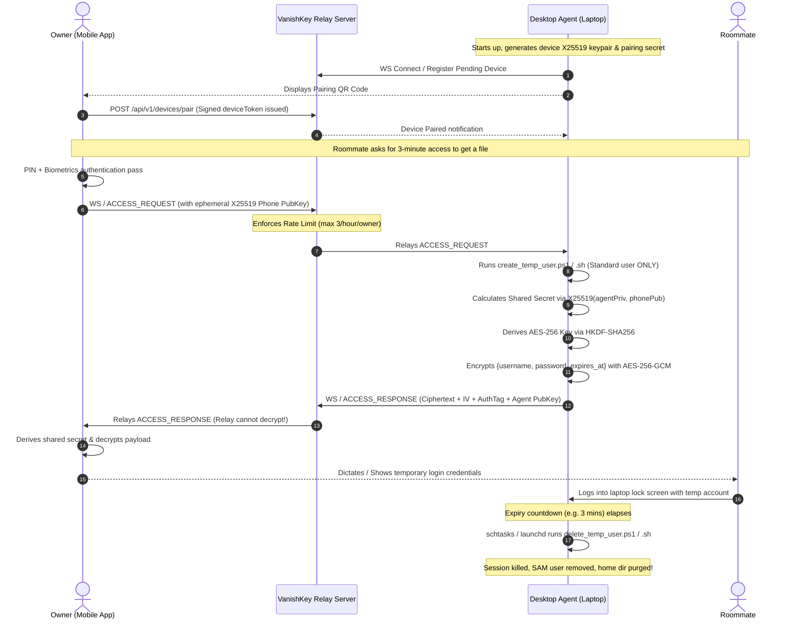

# VanishKey End-to-End Cryptographic Protocol

VanishKey provides zero-knowledge credential generation: **The relay server never sees or stores generated credentials in plaintext.** All credential exchange is protected by an authenticated Diffie-Hellman key exchange (X25519) combined with AES-256-GCM authenticated encryption.

## 1. Cryptographic Primitives

| Component | Primitive | Specification |
| :--- | :--- | :--- |
| **Asymmetric Key Exchange** | Curve25519 (X25519) | RFC 7748, 32-byte public/private keys |
| **Key Derivation Function** | HKDF-SHA256 | RFC 5869, info = `"VanishKey_v1_SessionKey"` |
| **Symmetric Cipher** | AES-256-GCM | NIST SP 800-38D, 12-byte IV, 16-byte Auth Tag |
| **Transport Layer** | TLS 1.3 / WSS | Authenticated, transport-level confidentiality |
| **Ephemeral Passwords** | CSPRNG | 24-char high-entropy string (96+ bits of entropy) |

---

## 2. Protocol Sequence



---

## 3. Data Payloads

### Ephemeral Decrypted Credential (Mobile Only)
```json
{
  "username": "VK_Temp_7E12A0",
  "password": "v8K#9d$mP2q!Lz-7A@b4W+eY",
  "created_at": "2026-11-01T03:00:00.000Z",
  "expires_at": "2026-11-01T03:03:00.000Z",
  "duration_seconds": 180
}
```

The relay server only ever witnesses the opaque ciphertext block:
```json
{
  "type": "ACCESS_RESPONSE",
  "requestId": "req_84729482",
  "deviceId": "dev_windows_laptop_1",
  "encryptedPayload": "4dFa3e...",
  "iv": "3mP9...",
  "authTag": "81fE...",
  "agentPublicKey": "qW81..."
}
```
